# 智审图档 · SmartDoc Vision

> 多模型驱动的档案图档智能审核平台。让每一份图档都经过可配置、可追溯、可复核的智能审核。

**SmartDoc Vision** 是一个面向档案、图纸、扫描件与文本内容的审核中台。后端使用 **Go + Gin**，数据层使用 **MySQL + Redis**，管理后台使用 **Vue 3 + TypeScript + Naive UI + ECharts**。平台支持**通用大模型**（OpenAI 兼容协议或 **Anthropic Claude Messages API**，两者属于同一业务分类，仅协议不同），并原生支持 **JEV / TypeSafe System One** 结构化决策模型。

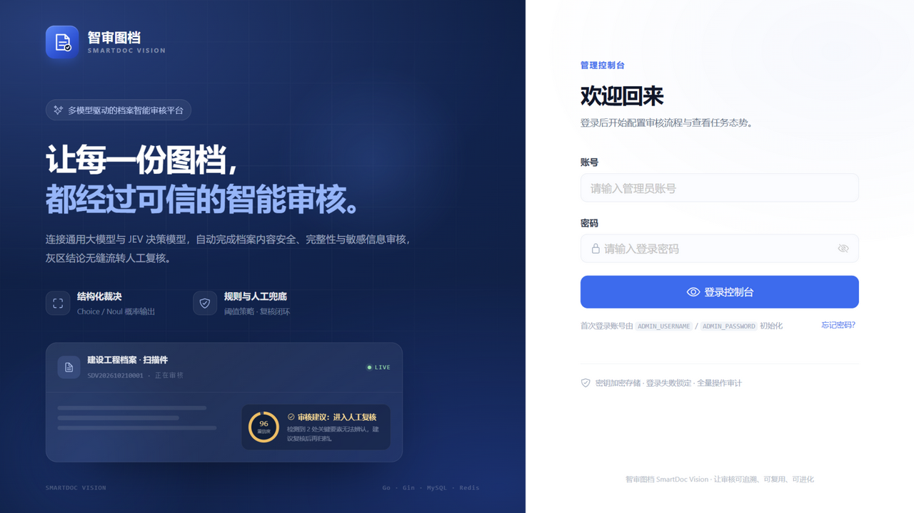

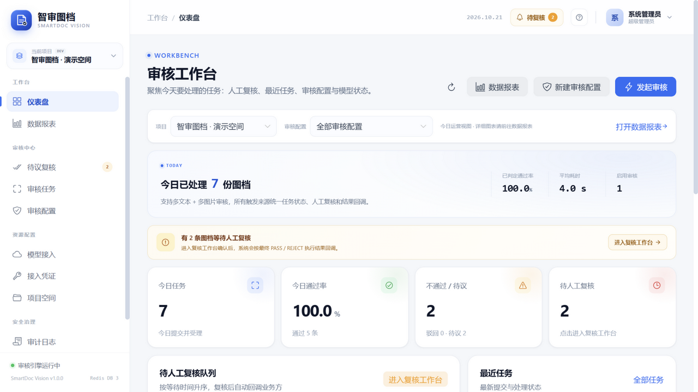

## 已实现能力

| 模块 | 能力 |
|---|---|
| 认证与安全 | JWT 登录、滑块拼图验证码、同一 IP 连续 3 次失败封禁 10 分钟、账号失败锁定（Redis）、TOTP 两步验证、服务端令牌撤销与自动刷新、密钥 AES-256-GCM 加密、界面脱敏、关键操作审计 |
| 项目空间 | 多项目隔离、启停、软删除与回收站恢复、环境标识 |
| 接入凭证 | 项目内多 AppKey、按审核配置授权、启用/停用、轮换、删除；审核删除后访问自动失效 |
| 账号与权限 | 内置角色（超管/项目管理员/审核配置员/复核员/只读）、自定义角色与菜单/操作权限组合、项目数据范围、个人中心改密、2FA 重置 |
| 模型接入 | 通用大模型（一个业务分类，OpenAI 兼容 / Anthropic Messages 只是 API 协议）、JEV System One（Choice / Noul）、模型列表与能力探测、自定义请求头、连接测试、失败自动切换与熔断恢复 |
| 审核配置 | 合规审核 / 分类审核 / 纯分类器三种模式、媒体类型、模型绑定、审核要求 Prompt、规则模板与规则 JSON 编辑、分类映射与置信度兜底、分类类型 CSV/JSON 导入导出、默认结论、模型失败兜底、去重窗口、版本号 |
| 任务引擎 | 项目级调度队列 + 并发 Worker 名额 + 公平轮询、异步 Worker 池、项目每日配额、幂等去重、状态机、结构化审核、规则判定、灰区转人工复核、结果动作路由（HTTP / WebSocket / Redis / JS）、业务回调、失败重试 |
| 规则引擎 | AND/OR 条件组、优先级、stop_on_hit、模型分数/风险等级/标签、扩展字段、媒体字段等 |
| 触发接入 | 开放 API（HMAC + 防重放 + 审核授权范围 + 每分钟限流）、Redis Stream（项目级 Redis 连接 + DB 0~255 + 独占 Stream）、WebSocket（含结果推送），每个审核配置独立开关 |
| 结果回调 | 可配置回调 URL / Secret / 需要回调的结论 / 是否回传原内容；支持 HTTP(S) Webhook 与 WebSocket 推送，HMAC-SHA256 签名、自动重试、幂等键 |
| 人工复核 | 独立复核工作台、等待时长排序、媒体与规则命中预览、详细复核上下文（转人工原因、风险分/等级、分类置信度、规则命中、模型依据）、建议原因码、PASS/REJECT 后自动回调 |
| 数据报表 | ECharts 趋势、通过率、结论分布、分类审核分布、项目/审核维度对比、未通过原因、错误与延迟分布 |
| 审核导出 | 每个审核配置可按时间、状态、结论、触发来源、媒体类型、关键字筛选导出 UTF-8 CSV 任务记录 |
| AI 配置助手 | 通过流式对话收集审核要求，自动生成并保存审核配置与接入方式（开放 API / Redis / WebSocket）；支持单独让 AI 生成审核规则 JSON 或优化审核要求提示词，结果先预览、确认后再应用；Redis 只从当前项目已启用且测试成功的连接中选择；创建走需求采集，编辑先选择目标并只修改指定字段；支持 Markdown 回复、粘贴图片预览/移除、底部切换对话模型 |
| 平台体验 | 任务筛选视图保存、表格显示列设置、本地图片上传、项目与审核永久清理、按保留期自动清理、分类类型 CSV/JSON 导入导出 |
| 管理后台 | 仪表盘、数据报表、项目、模型接入、接入凭证、审核配置与接入指南、任务、待议复核、审计日志、回收站、用户与权限、个人中心；桌面/平板/手机响应式布局 |
| 文本编码 | 输入文本自动处理 UTF-8 BOM、GB18030/Big5 和常见 Latin-1 乱码，MySQL 连接与建表默认 utf8mb4 |
| 部署 | 本地开发模式、Docker Compose 一键部署、Nginx 反向代理 |
| 观测 | 结构化任务事件时间线、审计日志、运营工作台、ECharts 数据报表、Provider 健康状态、Prometheus `/metrics`（含项目 Worker 活跃/排队/上限） |

### 界面预览

| 人工复核工作台 | 数据报表 |
|---|---|
| 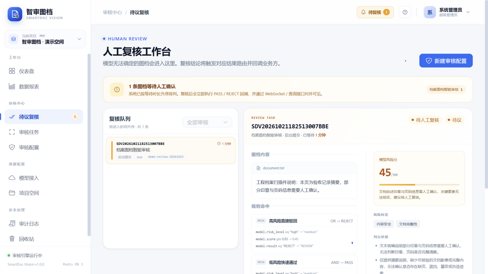 | 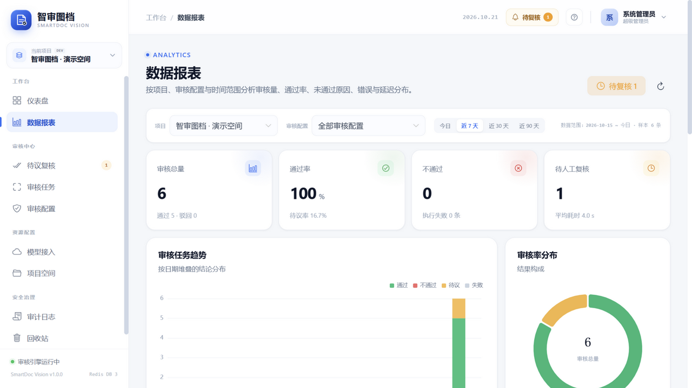 |

| 审核配置（合规 / 分类） | 分类任务详情 |
|---|---|
| 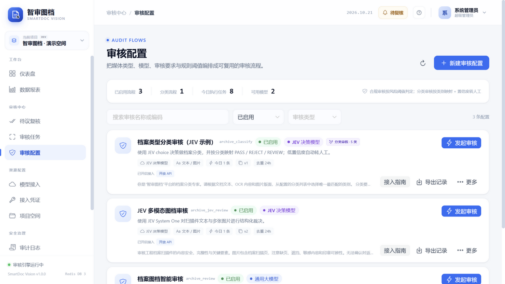 | 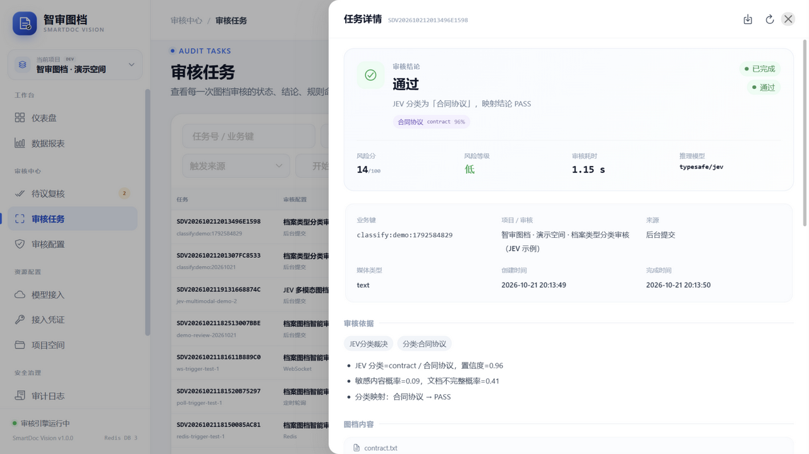 |

| 接入凭证（按审核授权） | 审核接入指南 |
|---|---|
| 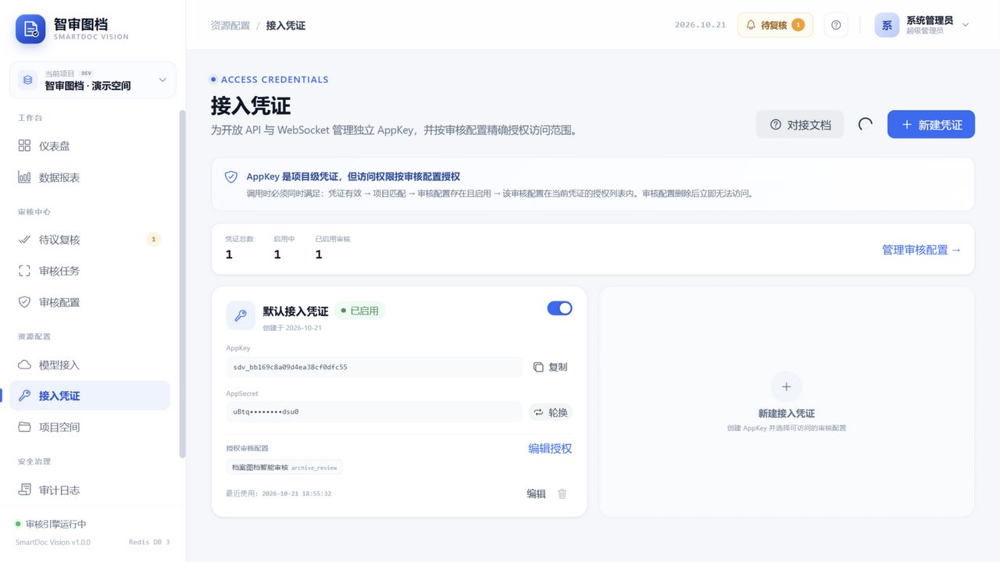 | 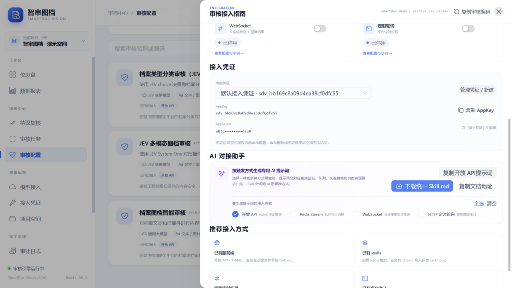 |

| 用户与权限 | 个人中心 |
|---|---|
| 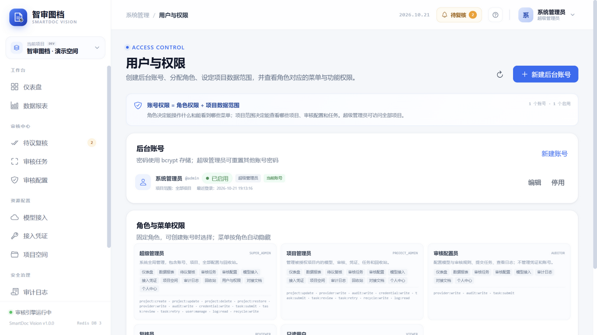 | 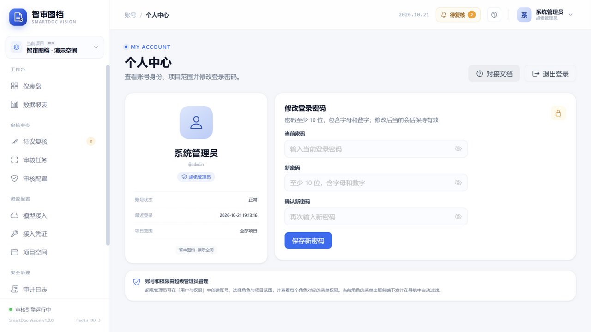 |

| 手机端审核配置 | 手机端 AI 接入助手 |
|---|---|
| 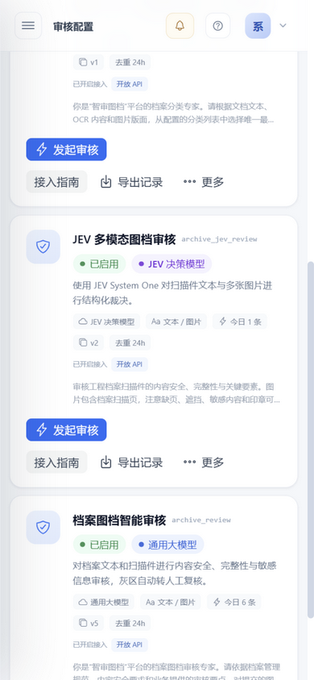 | 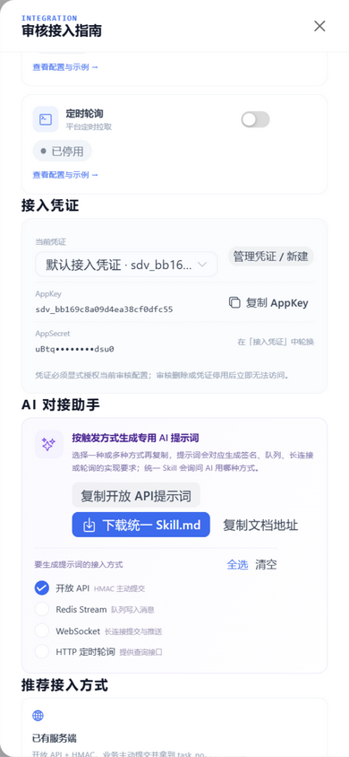 |

## 架构

```text
Vue 3 + TS + Naive UI (Vite)
            │ /api/admin/v1
            ▼
        Gin API  ──────────────┐
            │                  │
            ├─ MySQL 5.7+/8    │  smart-doc-vision
            │  项目 / 模型 / 审核 / 任务 / 审计
            │                  │
            ├─ Redis DB 3      │  去重键 / 登录锁定 / 健康状态
            │                  │
            └─ Audit Engine    │  异步 Worker Pool
                   │
          ┌────────┴─────────┐
          ▼                  ▼
  通用大模型 Adapter      JEV / TypeSafe Adapter
  /chat/completions      /v1/systemone
  JSON 结构化审核          Choice + Noul 概率裁决
```

### 任务主链路

```text
提交任务 → 校验项目/审核/模型 → 幂等去重 → 写入 QUEUED → Redis 去重键
   → Worker 领取 → 模型审核 → 规则判定 → PASS / REJECT / REVIEW
   → SUCCESS / REVIEW_PENDING → 人工复核 → 回调业务方
```

状态与审核结论分离：`status` 表示流程状态，`result` 表示审核结论，避免“REJECT 被误认为执行失败”。

## 快速开始（本地）

### 1. 环境要求

- Go 1.23+
- Node.js 20+
- MySQL 5.7+ / 8.0（建议 8.0，字符集 `utf8mb4`）
- Redis 6+（本项目默认使用 **DB 3**，无密码）

### 2. 初始化数据库

```sql
CREATE DATABASE IF NOT EXISTS `smart-doc-vision`
  CHARACTER SET utf8mb4 COLLATE utf8mb4_unicode_ci;
```

表结构由 GORM 在启动时自动迁移。首次启动会创建管理员、演示项目、默认审核配置，以及通用大模型 / JEV 两个供应商占位。

### 3. 配置文件

统一使用一个 `.env` 配置文件（也支持操作系统环境变量覆盖）。加载优先级为：

```text
操作系统环境变量  >  .env  >  内置默认值
```

- 管理后台固定入口：`http://127.0.0.1:<SERVER_PORT>/admin`，根路径 `/` 会自动跳转。
- MySQL 和 Redis 配置全部写在同一个 `.env` 中；MySQL 可用独立字段或完整 `MYSQL_DSN`，Redis 可用 `REDIS_ADDR` 或 `REDIS_HOST` + `REDIS_PORT`。
- 如果当前目录及其上级目录没有 `.env`，程序首次启动会自动生成一个带默认值和随机 JWT/MASTER 密钥的 `.env`。
- `build.ps1` 会把 `.env.example` 复制为 `dist/.env`（仅在不存在时），不会再生成其他配置文件。
- 旧版 `config.yml` 仅作为兼容兜底读取，但 `.env` 中的同名配置优先；新部署不再需要它。

`.env` 至少修改：

```dotenv
SERVER_PORT=8080

MYSQL_HOST=127.0.0.1
MYSQL_PORT=3306
MYSQL_USER=root
MYSQL_PASSWORD=你的密码
MYSQL_DATABASE=smart-doc-vision
MYSQL_CHARSET=utf8mb4

REDIS_HOST=127.0.0.1
REDIS_PORT=6379
REDIS_PASSWORD=
REDIS_DB=3

JWT_SECRET=一段足够长的随机字符串
MASTER_KEY=至少 32 字符的密钥
ADMIN_PASSWORD=你的管理员密码
```

> 当前工作区的本地 `.env` 已按本机 MySQL / Redis 配置好，且被 `.gitignore` 忽略。`dbhub.toml` 也已被忽略，避免数据库口令进入版本库。

如果本机的 `HTTP_PROXY` 指向不可用代理（例如 `127.0.01`），需要清空代理变量后再启动后端，否则访问模型 API 会失败：

```bash
https_proxy= http_proxy= all_proxy= no_proxy= go run ./cmd/server
```

### 4. 启动

```bash
# 终端一：后端
cd backend
go run ./cmd/server

# 终端二：前端
cd web
npm install
npm run dev
```

访问 <http://127.0.0.1:5173>。

首次使用（或新项目）请在「接入凭证」页面创建项目凭证，并勾选允许访问的审核配置；创建时复制一次 AppSecret。凭证是调用开放 API / WebSocket 的唯一机器身份。

默认管理员由环境变量初始化，示例配置下为：

```text
账号：admin
密码：Admin@123456
```

**首次登录后请立即修改管理员密码，并在生产环境更换 `JWT_SECRET`、`MASTER_KEY`。**

登录安全：

- 点击「登录控制台」后才弹出滑块拼图；默认登录页不加载、不展示验证码。验证码 120 秒有效、一次性使用，并绑定当前 IP。
- 同一 IP 连续 3 次登录失败后封禁 10 分钟；账号自身连续失败 5 次也会锁定一段时间。
- 验证码错误、密码错误都会计入失败次数；成功登录后重置连续失败计数。
- 错误码：`CAPTCHA_INVALID`（滑块失败/过期）、`IP_BLOCKED`（IP 封禁）、`LOGIN_LOCKED`（账号锁定）。

### 5. 验证

```bash
# 健康检查
curl http://127.0.0.1:8080/health

# 后端单元测试
cd backend && go test ./...

# 前端类型检查与生产构建
cd web && npm run build
```

## 单文件构建与发布（Windows / Linux）

除了前后端分离开发模式，项目支持把 **Vue 生产资源嵌入 Go 二进制**，生成一个可直接运行的执行文件。支持 Windows amd64、Linux amd64 和 Linux arm64。

在项目根目录执行：

```powershell
.\build.ps1
```

脚本会询问编译目标：

```text
1. Windows  amd64
2. Linux    amd64
3. Linux    arm64
4. 全部：Windows amd64 + Linux amd64 + Linux arm64
```

也可以非交互指定：

```powershell
.\build.ps1 -Target win
.\build.ps1 -Target linux
.\build.ps1 -Target linux-arm64
.\build.ps1 -Target all
.\build.ps1 -Target both -Upx
.\build.ps1 -Target all -Version 1.3.0
```

`-Upx` 会额外生成 Windows amd64 和 Linux amd64 的 UPX 压缩版本（文件名带 `-upx` 后缀），未压缩产物始终保留。未指定 `-Upx` 时，若检测到 `upx` 会询问一次；默认不压缩，避免个别安全软件把 UPX 壳误判为可疑程序。

版本号默认读取根目录 [VERSION](VERSION)，并会通过 `-ldflags -X` 写入程序；后台「模型接入」等页面显示的版本号来自 `/meta/system`。

构建流程：

1. 执行前端 `npm run build`，Vite 生产构建自动使用 `/admin/` 作为资源前缀；
2. 将 `web/dist` 复制到 `backend/internal/webui/dist`；
3. 使用 `CGO_ENABLED=0` 编译 Go 单文件程序；
4. 需要时用 `upx --best --lzma` 额外生成 Windows amd64 / Linux amd64 压缩版本（原产物保留）；
5. 输出到项目根目录 `dist/`。

生成文件示例：

```text
dist/smartdoc-vision-1.3.0-windows-amd64.exe
dist/smartdoc-vision-1.3.0-windows-amd64-upx.exe
dist/smartdoc-vision-1.3.0-linux-amd64
dist/smartdoc-vision-1.3.0-linux-amd64-upx
dist/smartdoc-vision-1.3.0-linux-arm64
dist/.env
```

构建时会生成 `dist/.env` 配置模板（已存在则不覆盖）。操作系统环境变量优先级最高，其余配置统一放在 `.env`。首次运行如果当前目录没有 `.env`，程序会自动生成带默认值和随机密钥的 `.env`。

运行（需要同目录或当前工作目录存在 `.env`）：

```powershell
.\dist\smartdoc-vision-1.0.0-windows-amd64.exe
```

Linux：

```bash
chmod +x dist/smartdoc-vision-1.0.0-linux-amd64
./dist/smartdoc-vision-1.0.0-linux-amd64

# ARM64
chmod +x dist/smartdoc-vision-1.0.0-linux-arm64
./dist/smartdoc-vision-1.0.0-linux-arm64
```

启动后打开：

```text
http://127.0.0.1:8080/admin
```

根路径 `/` 会自动跳转到 `/admin/`；前端静态资源、SPA 路由、管理 API（`/api/admin/v1`）和开放 API（`/open/v1`）都由同一个进程提供，不再需要单独部署前端或 Nginx。

> 单文件包含的是程序与前端页面，不包含数据库口令等敏感配置。MySQL、Redis、JWT_SECRET、MASTER_KEY 仍通过 `.env` 或环境变量注入。直接 `go run` 且未执行 `build.ps1` 时，`/admin` 会提示前端资源未打包，开发者继续使用 Vite `5173` 即可。

### GitHub Release 自动发布

发布流程位于 [.github/workflows/release.yml](.github/workflows/release.yml)，支持两种触发方式：

1. 推送 `v*` 标签；
2. 在 GitHub Actions 页面手动运行 `Release` 并填写版本号。

发布新版本：

```bash
# 同步更新 CHANGELOG.md 和 VERSION
git tag v1.0.0
git push origin main
git push origin v1.0.0
```

工作流会：

- 安装前端依赖并构建 Vue；
- 将前端资源嵌入 Go 程序；
- 执行 `go vet` 和 `go test`；
- 构建 Windows amd64、Linux amd64、Linux arm64；
- 额外生成 Windows amd64 / Linux amd64 的 UPX 压缩版本（`-upx` 后缀），原产物保留；
- 生成覆盖全部资产的 `SHA256SUMS.txt`；
- 从 [CHANGELOG.md](CHANGELOG.md) 提取对应版本更新内容；
- 创建或更新 GitHub Release，并上传全部可执行文件和校验和。

发布资产命名：

```text
smartdoc-vision-<version>-windows-amd64.exe
smartdoc-vision-<version>-windows-amd64-upx.exe
smartdoc-vision-<version>-linux-amd64
smartdoc-vision-<version>-linux-amd64-upx
smartdoc-vision-<version>-linux-arm64
SHA256SUMS.txt
```

UPX 压缩版本体积更小，但部分杀毒软件会对 UPX 壳产生误报；生产部署建议优先使用未压缩版本，或在受控环境验证后再使用压缩版本。

## Docker 部署

仓库提供多阶段构建和后端 / 前端镜像：

```bash
cp .env.example .env     # 填写 JWT_SECRET、MASTER_KEY、模型 Key、管理员密码
docker compose up -d --build
```

默认访问地址：<http://localhost:8088>。Nginx 会将 `/api/`、`/open/`（含 WebSocket Upgrade）和 `/health` 转发到后端容器，前后端同源，无需额外 CORS；本地 Vite 开发服务器同样代理 `/open`。

生产建议：

- MySQL 使用托管实例或 8.0 主从；
- Redis 开启持久化和访问密码；
- `MASTER_KEY` 使用 KMS 托管或独立密钥管理系统；
- 给 Nginx 配置 HTTPS；
- Worker 与 API 服务拆分部署（当前为同一进程内异步 Worker）。

## 审核接入与触发

每个审核配置在「审核配置 → 接入指南」中拥有三种独立开关，新审核创建成功后会自动打开接入指南：

| 触发方式 | 平台行为 | 业务方要做什么 |
|---|---|---|
| 开放 API | 校验项目凭证 + HMAC 签名 + 审核授权范围，支持同步/异步执行 | 按规范签名并 POST，可在返回中拿到 `task_no` |
| Redis Stream | 从项目「数据连接」中选择已启用且测试成功的 Redis 连接，指定 DB 0~255、Stream、消费组、消费起点与批量参数；一个 Stream 只允许一个审核消费 | 向约定 Stream XADD 标准 TaskInput，失败消息进入 `:dlq` |
| WebSocket | 签名连接后接收 `submit` 帧，返回 ACK，并主动推送终态 `result` 帧 | 建立长连接并处理心跳/重连 |

项目中新创建的审核会自动生成三种触发源（仅开放 API 默认启用）。Redis 触发在首次启用时必须选择项目 Redis 连接并填写 Stream；连接停用后绑定的触发源会自动暂停，网络恢复后按连接的「自动恢复触发」配置决定是否恢复，管理员手动停用连接后需要手动恢复触发源。AppKey/AppSecret 在「接入凭证」页面创建，每条凭证必须勾选允许访问的审核配置。接入指南内提供可按当前项目/审核编码直接复制的 cURL、带签名的 WebSocket 地址、Redis XADD 命令和回调报文。

> 平台自身缓存使用的 Redis 与项目「数据连接」中的业务 Redis 是两套独立配置。触发源不会使用平台缓存 Redis。

AI 对接助手按触发方式拆分：每个方式都有独立的专用提示词，避免把 HMAC、队列生产端和长连接的约束混在一份泛化提示词里；总览可多选方式生成组合提示词。下载的「统一 Skill.md」包含三种方式，并明确要求编码助手先询问业务方要接入哪一种或哪几种。HTTP/MySQL 轮询已下线。

完整规格见 [docs/INTEGRATION.md](docs/INTEGRATION.md)；后台右上角「?」、侧边栏「对接文档」，以及每个审核配置的「接入指南」都提供按当前项目/审核编码生成的实时示例。

### 项目级 Redis 连接

- 在「数据连接」页面按项目管理 Redis 连接，一个项目可以配置多个实例；每条连接独立配置地址、用户名、密码、TLS、启用状态和自动恢复开关。
- 审核触发只能选择当前项目、状态启用、最近测试成功且健康状态为 OK 的连接，再填写 DB（0~255）、Stream、消费组、消费起点、批量大小和最大并发。
- 一个 `(连接, DB, Stream)` 只能被一个审核消费；审核暂停时队列仍为它保留，删除触发源后才释放。
- 连接停用会暂停所有绑定的触发源；网络故障时平台标记连接不健康并暂停触发源，恢复后按「自动恢复触发源」决定是否继续。管理员手动停用连接后，即使重新启用也需要手动恢复触发源。
- 平台 Redis 仅用于自身缓存，不会出现在数据连接列表里；触发和结果动作只使用项目 Redis 连接。

### 结果回调

审核配置可以独立配置回调 URL、签名 Secret、需要回调的结论（PASS / REJECT）以及是否回传原内容。回调地址支持 `http(s)://` Webhook 与 `ws(s)://` WebSocket：WebSocket 回调在握手请求头中携带同样的 `X-SmartDoc-*` 事件头与 HMAC 签名，连接建立后发送一条标准结果 JSON。自动审核进入待议时不会立即回调；人工复核完成后，以最终 PASS/REJECT 触发回调。回调失败按 1s / 2s / 4s 重试 3 次，并写入任务详情。

### 结果动作编排

审核配置的「结果动作回调」按最终结论（PASS / REJECT / REVIEW）分别编排，可在一个结论下串联多个动作：

| 动作 | 配置项 | 说明 |
|---|---|---|
| HTTP | method、url、params、headers、body、timeout_ms | `params` 与 `headers` 每行一个 `key: value`；body 留空时发送标准结果 JSON |
| WebSocket | url、headers、payload、timeout_ms | 仅支持 `ws://` / `wss://`，headers 用于握手鉴权，payload 留空时发送标准结果 JSON |
| Redis | connection_id、db、command、target、payload | 必须选择项目 Redis 连接；db 0~255；command 支持 `publish` / `set` / `xadd` |
| JS 脚本 | remark、script、timeout_ms、memory_mb | 直接写顶层代码，平台注入全局 `ctx`（无需 `main`）；可用 `ctx.mysql` / `ctx.pg` / `ctx.http` / `ctx.crypto` / `ctx.secret`，执行日志按审核配置查看 |

动作支持模板变量：`${task_no}`、`${task_id}`、`${biz_key}`、`${source_type}`、`${project_code}`、`${audit_code}`、`${result}`、`${summary}`、`${reasons}`、`${labels}`、`${risk_level}`、`${score}`、`${category}`、`${category_name}`、`${category_confidence}`、`${review_note}`。`on_error` 可选 `continue` / `stop` / `to_review`，执行结果写入任务详情的 `routes` 字段。后台已提供结构化编辑器，也可切换「高级 JSON」直接编辑；编辑器右上角的「变量说明」可查看每个变量的含义与取值形式。

变量的语义与坑：

- `${result}` 只会是 `PASS` / `REJECT` / `REVIEW`；人工复核后以人工结论为准。
- `${score}` 是 **0~1 的风险分，越高越危险**，不是通过率或置信度。模型调用失败走兜底时按结论取 `0.2`（PASS）/ `0.5`（REVIEW）/ `0.9`（REJECT）。
- `${category}` / `${category_name}` / `${category_confidence}` 只对分类类审核（分类器、JEV 分类）有值，普通文本审核通常为空；类别以审核配置里的分类列表为准，未知类型落在 `other`。
- `${reasons}` / `${labels}` 是数组。模板替换走纯文本拼接，渲染成空格分隔的裸文本（如 `[关键页缺失 缺章]`），直接塞进 JSON 会破坏格式 —— 需要结构化字段时把请求体 / 消息内容留空，让平台发送标准结果 JSON。
- 替换结果是字符串：`${task_id}`、`${project_id}` 等数字变量写进 JSON 时也会变成字符串，需要数值类型的业务方应改用标准结果 JSON。

> HTTP / WebSocket 结果动作默认启用 SSRF 防护，禁止访问内网与回环地址。本地联调需要回调到 `127.0.0.1` 时，仅在测试环境设置 `MEDIA_ALLOW_PRIVATE=true` 后重启后端。

#### JS 脚本动作

JS 脚本动作使用纯 Go 的 moejs 运行时。脚本直接写顶层代码，平台已注入全局 `ctx`，不需要定义主函数：

```js
ctx.log('审核结果', ctx.result)
const db = ctx.mysql.connect({
  host: '10.0.0.12', port: 3306,
  user: 'svc_audit', password: ctx.secret('BILLING_DB_PASSWORD'),
  database: 'billing'
})
db.exec('UPDATE orders SET audit_result = ? WHERE biz_key = ?', [ctx.result, ctx.task.biz_key])
db.close()
;({ ok: true })
```

- 平台记录脚本的完成值，最后一行可放对象/数组表达式，建议在行首加分号，避免被自动分号插入解析成上一行的函数调用。
- 旧脚本仍兼容 `function main(ctx) { ... }`；定义后平台会调用并记录其返回值。

- 脚本只能使用宿主注入的 `ctx` API，不提供文件读写、进程、socket、`eval`、`import`、定时器。
- 支持 MySQL / PostgreSQL 独立连接（脚本结束自动关闭）、HTTP/HTTPS 请求（不支持 socket 长连接）。
- 内置加解密：MD5 / SHA-1 / SHA-256、HMAC-MD5 / HMAC-SHA1 / HMAC-SHA256、Base64 / Hex、AES / DES（CBC / ECB，PKCS7 或 NONE，base64 或 hex 输出）、安全随机数与 UUID。第三方接口常见的「参数排序拼串 + 密钥签名」「AES-CBC 加密请求体」都可以直接拼装。
- 项目设置页可配置单次最大内存、时长、日志、返回值、HTTP 请求数/响应体、DB 行数和项目并发脚本数。
- 每次执行记录开始时间、耗时、状态（成功/脚本错误/超时/OOM/宿主错误）、完整日志和返回值，可在审核配置的「脚本日志」查看。
- 凭据建议使用项目密钥 `ctx.secret('NAME')`，不要写明文密码。项目密钥在「项目空间 → 对应项目 → 项目密钥」维护，按项目隔离注入；脚本编辑器的「API 文档」里有图文流程和「去配置项目密钥」按钮，可直接跳转到当前项目的密钥面板。
- 原 `mysql` 结果动作已移除；数据库写入请使用 JS 脚本的 `ctx.mysql` / `ctx.pg`。
- 编辑器提供语法高亮、`ctx` API 补全和右侧 AI 脚本助手。AI 是可读写编辑器的多轮 Agent：会按需读取/替换/插入/删除行、联网搜索和读取网页；不确定时会先提问。修改会直接写入编辑器，可用 Ctrl+Z 撤销，保存后才会落库；查询/解释类请求不会改动脚本。
- 助手输入区右侧的环形进度条显示本轮上下文占用（按 400000 Token 窗口估算，取最近一次请求的输入 + 输出并累加工具轮次）；点击可查看窗口、已用、剩余、请求次数、累计输入 / 缓存命中 / 输出 / 总量。每次调用同时计入「模型接入」的请求明细。
- 离开守卫：脚本有未保存修改或 AI 请求正在运行时，关闭编辑器、去配置项目密钥、路由跳转、刷新/关闭标签页都会先弹窗确认，确认后才会停止 AI 并离开，避免误丢修改。
- 编辑器右上角的「运行」支持沙盒模拟：默认使用当前脚本所在结论（PASS / REJECT / REVIEW）作为模拟结果，点击旁边的齿轮可改任务号、业务主键、输入文本、`ctx.detail` 摘要 / 风险 / 原因 / 标签 / 分类等参数。模拟运行时 `ctx.secret`、MySQL / PostgreSQL 连接和 `ctx.http` 全部返回占位数据，不会读取密钥或产生真实副作用；结果面板分「临时日志 / 返回值 / 临时变量」三栏，可展开为更高的面板，内容支持独立滚动；收起后底部常驻「展开结果」入口；日志超过 1000 行时只渲染最近 1000 行，避免长日志拖慢编辑器。模拟运行不落执行记录，真实日志仍在「脚本日志」查看。

### MySQL 说明

标准三种触发方式中没有“直连业务 MySQL”，也没有 HTTP/MySQL 轮询。平台 MySQL 存储项目、审核、任务、审计与报表数据；业务 MySQL 需要由业务方自行查询、脱敏和做增量控制，然后通过开放 API、Redis Stream 或 WebSocket 主动推送 TaskInput。原因和安全边界见 [对接文档的 MySQL 章节](docs/INTEGRATION.md#8-mysql-与业务数据库)。

## 后台账号与权限

系统不开放自助注册，只有**超级管理员**可以在「用户与权限」创建后台账号。

- 创建账号时设置初始密码、角色、状态与授权项目。
- 角色决定菜单可见性与操作权限：超级管理员、项目管理员、审核配置员、复核员、只读用户。
- 项目范围决定该账号能查看哪些项目 / 审核配置 / 任务；所有列表和详情接口按范围校验。
- 超级管理员可重置其他账号密码；账号停用后立即无法登录。
- 所有用户可在右上角头像 →「个人中心」修改自己的登录密码；密码至少 10 位并同时包含字母和数字。
- 菜单由服务端根据角色下发，前端导航自动隐藏无权限入口；后端仍会独立校验写操作和项目范围。
- 「系统管理 → 运行监控」默认仅超级管理员可见；自定义角色需要同时勾选 `monitor` 菜单和 `system:monitor` 权限才能访问。

## 运行监控

超级管理员可在「系统管理 → 运行监控」查看服务运行状态，所有指标以图表展示并支持最近 1 小时 / 6 小时 / 24 小时切换：

- 运行时间、Go 堆内存与进程内存、协程数、操作系统线程数、GC 次数与暂停耗时；
- 每个采样区间的请求量、HTTP 4xx/5xx 错误数、当前处理中请求数（并发）和平均响应耗时；
- 各项目独立 Worker 池的执行中任务、并发上限与排队数量，以及任务状态汇总；
- MySQL / Redis 依赖状态和连接池使用情况；
- 主机级 CPU 使用率与物理内存占用，仅作参考（Linux 读取 `/proc`，Windows 调用系统 API）。

指标每 10 秒采样一次，在进程内保留 24 小时；服务重启后历史清空。Prometheus 抓取仍使用 `/metrics`，不受影响。

为了不让监控本身拖慢服务：内存统计只在采样协程中读取（不会在每次接口请求时触发 stop-the-world 的 `ReadMemStats`），任务状态汇总缓存 30 秒，监控接口默认最多返回 120 个降采样点；前端图表关闭动画，标签页隐藏时暂停轮询，并且不会叠加并发请求。

## 审核记录导出

每个审核配置卡片提供「导出记录」按钮，先打开筛选弹窗，可以按时间范围、任务状态、审核结论、触发来源、媒体类型和任务号/业务键关键字筛选，不会无条件直接导出全部。

生成 UTF-8 BOM 的 CSV（Excel/WPS 可直接打开），包含：

任务号、业务键、状态、结论、分类编码、分类名称、分类置信度、风险等级、风险分、标签、摘要、原因、来源、模型、耗时、创建/完成时间、人工复核信息。

对应接口：

```http
GET /api/admin/v1/audits/{aid}/export?start=2026-10-01&end=2026-10-31&status=SUCCESS&result=PASS&source_type=OPENAPI&media_type=mixed&keyword=SDV2026
```

导出行数上限 100000；CSV 已做公式注入转义。

## 模型接入

> **通用大模型是一个业务分类**，OpenAI 兼容与 Anthropic Messages 只是两种 API 协议；JEV 是独立的结构化决策模型。

### 模型列表、能力与失败切换

- 「获取模型」会调用供应商的 `/models` 接口；只有接口实际返回的上下文窗口、最大输出、图片理解、推理能力才会自动带入。接口未提供的字段保持空白，由管理员手动填写。
- 「上下文窗口」「最大输出 Token」均可手动配置；最大输出上限为 200000（仅作安全边界，实际以模型规格为准）。
- 模型标记为「支持推理」后，可开启「优先使用推理」；失败切换时同类别模型会优先选择支持推理的模型。
- 「自定义请求头」每行一个 Header。部分 OpenCode 兼容网关需要 `x-opencode-session`；平台默认自动附带随机会话 ID，测试连接和熔断恢复探测会强制使用新的随机值。
- 审核调用失败时会立即尝试项目内同类别（通用模型 / JEV）的下一个启用模型；失败模型进入熔断冷却（30 秒起指数增长，最长 10 分钟），冷却期间不再参与调度。
- 同类型模型支持「优先级」1~999，数字越小越优先：审核配置绑定的模型始终最先调用，失败或熔断后其余同类模型按优先级依次回落；优先级相同再参考推理偏好与创建顺序。AI 配置/脚本助手在未指定模型时也会选择优先级最高且已启用的通用大模型。
- 后台每 30 秒对到期熔断模型执行连接测试；测试通过后清除熔断并恢复可用，测试失败则延长冷却。手动「测试连接」成功也会立即清除熔断。

### 请求用量与 Token 统计

- 每次模型调用都会写入请求明细：来源（审核任务 / 脚本助手 / 配置助手）、输入 Token、缓存命中、输出 Token、总 Token、耗时与成功/失败。失败的调用也计入请求量，但没有 Token 数据。
- 模型卡片显示累计请求量与总 Token；通用大模型额外显示输入 / 缓存命中 / 输出，JEV 决策模型只统计输入（其输出免费），与供应商计费口径一致。
- 点击卡片上的「请求明细」可查看该模型最近 80 次请求及累计汇总。
- Token 数据来自供应商响应：OpenAI 兼容读取 `usage.prompt_tokens` / `completion_tokens` / `prompt_tokens_details.cached_tokens`（兼容 DeepSeek 的 `prompt_cache_hit_tokens`）；Anthropic 读取 `usage.input_tokens` / `output_tokens` / `cache_read_input_tokens`；JEV 读取 `usage.input_tokens` / `output_tokens`。网关不返回 usage 时明细仍会记录，Token 显示为 0。

### 通用大模型 · OpenAI 兼容协议

配置字段：

| 字段 | 说明 |
|---|---|
| BaseURL | 例如 `https://api.openai.com/v1`，平台自动追加 `/chat/completions` |
| 模型 ID | 例如 `gpt-4o-mini`、`deepseek/deepseek-v4.1-flash` |
| API Key | AES-256-GCM 加密存储，仅展示脱敏值 |
| 图片理解 | 若模型支持视觉输入则开启；否则纯图片任务会被拒绝并提示改用 JEV |
| 最大 Token / 温度 | 推理参数 |

审核调用会要求模型返回严格 JSON：`result / risk_level / score / labels / summary / reasons`，再进行规则二次判定。

### 通用大模型 · Anthropic Messages 协议

通用大模型也支持 Anthropic Messages API，仍归入「通用大模型」分类；供应商类型选择 `ANTHROPIC`（API 也兼容 `CLAUDE`）：

| 字段 | 说明 |
|---|---|
| BaseURL | 例如 `https://api.anthropic.com/v1`，平台自动追加 `/messages` |
| 模型 ID | 例如 `claude-sonnet-4-5` |
| API Key | 通过 `x-api-key` 请求头发送，AES-256-GCM 加密存储 |
| 图片理解 | 开启后平台会下载图片、做 SSRF/尺寸/格式处理后，以 base64 `image` 内容块提交 |
| 最大 Token / 温度 | 作为 `max_tokens` 和 `temperature` 传给 Messages API |

Anthropic 返回的文本内容会按与 OpenAI 相同的 JSON 契约解析，并进入规则引擎；分类审核同样支持 Anthropic 输出 `category` 与 `category_confidence`。连接测试会发送一条最小 Messages 请求。

> **当前审核输入仅支持多文本 + 多图片，不支持视频/音频。**通用大模型需要开启「图片理解」并使用支持视觉输入的模型；JEV 原生支持多图。单次 JEV 请求最多 8 张图片。

### 文本编码与乱码防护

- 平台收到 `media[].content` 后会统一做编码规范化再入库和送模型：处理 UTF-8 BOM、NULL 字符、GB18030/GBK、Big5，以及常见的“GBK 被按 Latin-1 解码”乱码。
- MySQL DSN 缺少 charset 时自动补 `charset=utf8mb4`；新建表统一使用 `utf8mb4_unicode_ci`。
- CSV 导出使用 UTF-8 BOM，Excel/WPS 打开中文不乱码。
- 业务方仍应优先以 UTF-8 JSON 提交内容；如果历史系统只能输出 GBK，请直接提交原始中文字符串，不要先做二次转码。

### JEV / TypeSafe System One

JEV 不使用自由文本 Prompt，而是 `state + questions` 的结构化裁决：

- `Choice`：在 PASS / REVIEW / REJECT 三个候选中裁决；
- `Noul`：判断“是否包含敏感内容”“文档是否不完整”两个概率问题；
- 图片自动下载、SSRF 校验、尺寸归一化（280~1568px）、PNG/JPEG 重新编码后，以 base64 asset 提交。

详细协议、请求/响应示例和风险归一化公式见 [docs/JEV.md](docs/JEV.md)。

演示环境已创建审核配置 `archive_jev_review`（JEV 多模态图档审核），并使用 **2 张图片 + 1 段文本** 提交了测试任务；任务进入人工复核以验证多模态链路。

### 分类审核配置

审核配置支持三种决策模式：

| 模式 | 模型输出 | 终审方式 | 适用场景 |
|---|---|---|---|
| 合规审核 `REVIEW` | `result` + 风险分 | 规则模板按风险阈值判定 PASS / REJECT / REVIEW | 内容安全、档案完整性、敏感信息审核 |
| 分类审核 `CLASSIFY` | `category` + `category_confidence` + 风险信息 | 按分类映射结论；通过类别的置信度低于阈值时自动转人工 | 档案类型、票据/合同/图纸分类、按类别分流 |
| 纯分类器 `CLASSIFY_ONLY` | `category` + `category_confidence` | **成功分类一律 PASS**，不做驳回判定；`category` / `category_name` 就是业务需要的类型值；创建时自动加入可编辑的 `unknown / 未知` 类型 | 标签、归档类别、工单类型、内容路由 |

分类审核的每个分类都配置：

- `code`：稳定分类编码（小写字母开头，写入结果 `category`）；
- `name`：展示名称（写入结果 `category_name`）；
- `description`：给模型的判定说明；
- `result`：该类别的终审映射结论（PASS / REJECT / REVIEW）。纯分类器会忽略 result 并统一存为 PASS。
- 纯分类器创建时会自动加入 `unknown / 未知` 类型，名称和说明可编辑，确保模型无法判断时仍有明确返回值。

分类类型支持 **CSV / JSON 导入导出**：

- CSV 表头：`code,name,description,result`（也兼容中文表头 `分类编码,分类名称,判定说明,映射结论`）；
- JSON：分类对象数组，或包含 `categories` 数组的对象；
- 纯分类器导入时忽略 result，统一使用 PASS，单条配置最多 200 个类型；
- 导出文件可用于其他审核配置批量导入。

**推荐使用 JEV 决策模型**：JEV 的 `choice` 问题会直接返回分类编码、置信度和概率分布；通用大模型也可以按 JSON 输出分类，但稳定性和可解释性较弱。新建分类审核时，如果项目已有启用的 JEV 模型，表单会自动预选；编辑时若使用通用模型会显示切换提示。

演示环境已通过 Seed 自动创建：

- `archive_classify`「档案类型分类审核（JEV 示例）」：分类映射 + 低置信度转人工；
- `archive_classifier`「档案类型分类器（纯分类示例）」：5 个分类类型，成功审核固定 PASS，结果直接返回 `category`。

分类结果详情、回调、CSV 导出和数据报表都会带上 `category`、`category_name`、`category_confidence`，报表额外提供分类分布。

## 目录结构

```text
smart-doc-vision/
├── backend/
│   ├── cmd/server/            # 服务入口
│   ├── internal/
│   │   ├── ai/                # OpenAI / Anthropic / JEV 适配器
│   │   ├── api/               # Gin 路由与 Handler
│   │   ├── catalog/           # 规则模板、默认配置
│   │   ├── engine/            # 异步审核引擎、回调
│   │   ├── media/             # 图片下载、SSRF 防护、尺寸归一化
│   │   ├── model/             # 数据模型
│   │   ├── rules/             # 规则引擎
│   │   ├── security/          # JWT / AES-GCM / bcrypt
│   │   └── store/             # MySQL / Redis / 初始化数据
│   └── Dockerfile
├── web/
│   ├── src/
│   │   ├── api/               # Axios 封装与 API 类型
│   │   ├── components/        # 任务详情、提交弹窗、图表等
│   │   ├── layouts/           # 管理后台框架
│   │   ├── stores/            # Pinia
│   │   └── views/             # 各业务页面
│   ├── Dockerfile
│   └── nginx.conf
├── docs/
│   ├── JEV.md
│   └── screenshots/
├── docker-compose.yml
├── .env.example
└── Makefile
```

## 开放 API

| 方法 | 路径 | 说明 |
|---|---|---|
| POST | `/open/v1/projects/{project_code}/audits/{audit_code}/submit` | 签名提交任务 |
| GET | `/open/v1/projects/{project_code}/tasks/{task_no}` | 签名查询任务结果 |
| WS | `/open/v1/ws/projects/{project_code}/audits/{audit_code}` | WebSocket 触发与结果推送 |

## 主要管理 API

统一前缀：`/api/admin/v1`

| 方法 | 路径 | 说明 |
|---|---|---|
| GET | `/auth/captcha` | 获取滑块拼图验证码（公开接口） |
| POST | `/auth/login` | 登录（必须携带 captcha_id / captcha_x） |
| POST | `/auth/refresh` | 刷新 Token |
| GET | `/auth/me` | 当前用户 |
| GET/POST | `/projects` | 项目列表 / 创建 |
| PATCH | `/projects/:id/status` | 启用 / 暂停 |
| DELETE | `/projects/:id` | 软删除到回收站 |
| GET/POST | `/providers` | 模型供应商列表 / 创建 |
| POST | `/providers/:id/test` | 测试模型连接 |
| GET/POST | `/audits` | 审核配置列表 / 创建 |
| PATCH | `/audits/:id/status` | 审核启停 |
| POST | `/audits/:id/clone` | 复制审核配置 |
| GET | `/audits/:id/integration` | 生成接入指南、签名示例与触发配置 |
| GET | `/audits/:id/export` | 按时间/状态/结论/来源/媒体/关键字筛选导出该审核配置的 CSV |
| PUT | `/trigger-sources/:id` | 更新触发源配置/开关 |
| POST | `/trigger-sources/:id/test` | 测试 Redis 触发（连接 + DB + Stream + 消费组） |
| GET/POST | `/tasks` | 任务列表 / 提交审核 |
| GET | `/tasks/:id` | 任务详情与事件时间线 |
| POST | `/tasks/:id/review` | 人工复核 |
| POST | `/tasks/:id/retry` | 重试失败任务 |
| GET | `/reviews/summary` | 待复核数量与按审核分布 |
| GET | `/dashboard` | 仪表盘指标 |
| GET | `/analytics` | 项目/审核维度统计、分类分布、原因与延迟分布 |
| GET/POST | `/users` | 后台账号列表 / 创建账号（仅超级管理员） |
| PUT | `/users/:id` | 更新账号角色、状态、项目范围、密码（仅超级管理员） |
| POST | `/auth/change-password` | 修改当前登录用户密码 |
| GET/POST | `/projects/:id/credentials` | 查询/创建项目接入凭证（创建时返回一次 AppSecret） |
| PUT | `/projects/:id/credentials/:cid` | 修改凭证授权审核范围/状态 |
| POST | `/projects/:id/credentials/:cid/rotate` | 轮换凭证密钥 |
| DELETE | `/projects/:id/credentials/:cid` | 删除凭证 |
| GET | `/audit-logs` | 审计日志 |
| GET | `/recycle-bin` | 回收站 |

成功响应：

```json
{ "code": 0, "message": "OK", "data": {}, "trace_id": "..." }
```

失败响应使用业务错误码：`INVALID_PARAM`、`UNAUTHORIZED`、`PERM_DENIED`、`CODE_CONFLICT`、`PROVIDER_DISABLED`、`INTERNAL_ERROR` 等。

## 安全设计

- 密码使用 bcrypt；登录前必须完成后端校验的滑块验证码；
- 同一 IP 连续 3 次失败封禁 10 分钟，账号连续失败 5 次锁定 15 分钟（Redis）；
- 模型 API Key 使用 AES-256-GCM + `MASTER_KEY` 派生密钥加密，数据库不存明文；
- API 返回的密钥字段统一脱敏；
- 图片下载与回调地址默认启用 SSRF 防护，禁止内网 / 回环 / 链路本地地址；
- 配置变更、模型测试、任务提交、人工复核等操作记录审计日志；
- 所有任务状态变更记录 `task_event`，可用于时间线回放；
- JWT 区分 access / refresh 类型；
- 前端只在 localStorage 保存 Token（生产可按需要改为 HttpOnly Cookie）。

## 当前实现边界

这份代码已覆盖核心审核闭环和主要平台能力，当前明确未实现或不在本次范围：

- 视频/音频审核与大文件异步媒体处理（产品边界，当前仅支持多文本 + 多图片）；
- 字段级权限（角色级操作权限、菜单权限与项目数据范围已实现）；
- 邮件 / 短信 / 站内通知与外部告警推送（Prometheus 指标已提供，可接 Alertmanager）；
- 平台直连业务 MySQL 的数据源（业务方应自行查询后通过开放 API、Redis Stream 或 WebSocket 推送）；
- 原生 XLSX 导出（当前导出 UTF-8 CSV，可直接用 Excel 打开）；
- 拖拽式规则条件组编辑器（当前提供模板与结构化 JSON 编辑器，保存前做服务端校验）。

建议的下一阶段优先级：

1. 告警渠道（邮件 / 企业微信 / 钉钉）与通知中心；
2. 原生 XLSX / 大文件异步导出；
3. 字段级权限与更细粒度数据脱敏；
4. 视频/音频审核与异步媒体处理（按产品规划再评估）。

## 设计文档落地对照

| 设计能力 | 当前状态 |
|---|---|
| 项目隔离、项目配置 | ✅ 项目 / 模型 / 审核均按 `project_id` 隔离 |
| 模型与 JEV 双接入 | ✅ 通用适配器 + JEV System One（支持多文本 + 多图片；无视频） |
| 触发源 | ✅ 开放 API / Redis Stream / WebSocket，审核配置级开关；Redis 使用项目级连接 |
| 审核定义 / 规则 / 兜底 | ✅ 规则模板 + 自定义规则 JSON 持久化 |
| 幂等去重 | ✅ Redis 去重键 + DB 窗口内查询 |
| 三条结果路线 | ✅ PASS / REJECT / REVIEW，灰区进入人工复核 |
| 结果路由动作 | ✅ 业务回调 + HTTP / WebSocket / Redis / MySQL 结果动作编排，支持参数、请求头、失败策略与执行记录 |
| 回收站 | ✅ 项目 / 审核软删除、恢复、保留期计算 |
| 审计日志 | ✅ 管理操作与任务事件全量入库 |
| 监控看板 | ✅ 运营工作台 + ECharts 项目/审核数据报表；Prometheus `/metrics` 已接入，告警渠道未接入 |
| 多项目资源隔离 | ✅ 数据、凭证、审核授权、配额、限流、项目级任务队列、并发 Worker 名额与公平调度已完成；MySQL/Redis 为平台共享连接池（单实例架构） |

## 宣传视频

仓库内置独立的 Remotion 工程 `video/`，用于生成 40 秒 1080p 产品宣传片：

```bash
cd video
npm install
SDV_TOKEN=<后台 access_token> npm run capture   # 采集当前界面的高清截图
npm run render                                  # 输出 out/smartdoc-vision-promo.mp4（品牌介绍版）
node scripts/make-beat.mjs                      # 合成 120 BPM 原创配乐（40 秒）
npm run render:launch                           # 输出 out/smartdoc-vision-launch.mp4（发布会卡点版）
npm run studio                                  # 可视化调整分镜
```

发布会卡点版使用 120 BPM、40 秒的原创电子配乐，画面按拍点切换并叠加冲击波、闪光、震屏与频谱；配乐由 `scripts/make-beat.mjs` 用振荡器和噪声合成，无第三方版权素材。

截图脚本使用无头 Chrome 打开本地前端（默认 `http://localhost:5173`），通过 `SDV_TOKEN` 注入登录态；可用 `BASE_URL`、`BROWSER_PATH` 覆盖默认值。

## License

MIT License，见 [LICENSE](LICENSE)。第三方 SDK / 模型服务遵循各自许可和服务条款。
